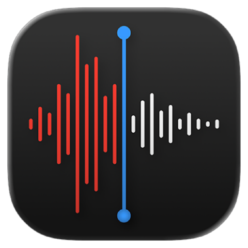

<p align="center">
  
</p>

# apple-voicememos-mcp

A local MCP server, written in Swift, exposing macOS **Voice Memos** to Claude: list
recordings, read their metadata, transcribe them on-device with Apple's `Speech`
framework, and export a copy of the audio. It ships as a Claude extension.

Voice Memos has no scripting dictionary and no framework — it is one of the few Apple
apps with neither. So recordings are reached as files on disk rather than through an
API, and there is no network and no cloud transcription anywhere in this server.

Not affiliated with or endorsed by Apple Inc.

## Requirements

- macOS 26 (Tahoe) or later — required by `SpeechAnalyzer`/`SpeechTranscriber`, the
  on-device speech framework this server transcribes with
- Swift 6.2 or later (Xcode 26 ships it)
- A code signing identity. Ad-hoc works, but every rebuild then asks for permission
  again — see [Signing](#signing-and-why-it-is-not-optional).

## Tools

| Tool | Kind | What it does |
|---|---|---|
| `recordings_status` | read | Reports which recording library this server can reach, whether Speech Recognition is granted, whether the on-device model for the recognition locale is installed, and where exports and cached transcripts go. Reads no audio. |
| `recordings_list` | read | Recordings newest first (ties by id), one page at a time: id, name, date, duration, folder. `from_date` and `to_date` bound the range, `name_contains` and `folder` filter, `limit` and `offset` select the page. |
| `recording_get` | read | Full record for several `ids` at once (at most 10): name, file name, full path, folder, dates, duration, size and file type. No audio, no transcript. |
| `recording_transcribe` | read | Transcribes recordings to text with `Speech`'s on-device `SpeechAnalyzer`/`SpeechTranscriber`, in the recognition `locale` given or the configured one. Each transcript is returned through a window; `character_offset` and `max_characters` read the rest. See below. |
| `recording_export` | write | Copies the recording with the given `id` into the configured export folder, at `destination` inside it. The original is never moved, renamed or touched. |

## Frameworks and APIs

Voice Memos ships no framework and is not scriptable, so recordings are read as files.

| Used | For | Reference |
|---|---|---|
| Speech — `SpeechAnalyzer`, `SpeechTranscriber`, `AssetInventory` (macOS 26, Swift-only); `SFSpeechRecognizer` for authorisation only | Transcription, forced on-device | [Speech](https://developer.apple.com/documentation/speech) |
| AVFoundation — `AVURLAsset`, `AVMetadataItem`, `AVAudioFile` | Title, duration, and reading the audio | [AVFoundation](https://developer.apple.com/documentation/avfoundation) |
| Foundation `FileManager` + `URLResourceKey` | Walking the library, and `recording_export`'s copy — the only write | [FileManager](https://developer.apple.com/documentation/foundation/filemanager) |
| CryptoKit — `SHA256` | Keying the transcript cache | [CryptoKit](https://developer.apple.com/documentation/cryptokit) |
| `NSSpeechRecognitionUsageDescription` | The consent string macOS shows | [Information Property List](https://developer.apple.com/documentation/bundleresources/information-property-list/nsspeechrecognitionusagedescription) |

The older Objective-C recognition pipeline is unused — `SFSpeechURLRecognitionRequest`,
`SFSpeechRecognitionTask`, `SFTranscription` and `SFTranscriptionSegment`, so there are no
per-word timings or confidences — as are custom language models and voice analytics. Of
AVFoundation, only asset metadata and file reading are touched: nothing captures, plays,
edits or exports audio.

## The rules worth knowing before you use it

**Nothing here can rename, move or delete a recording.** There is no such tool, on
purpose — this server reads and transcribes a library, it does not manage one. A test
walks the whole catalogue to keep it that way.

**Transcription is on-device and that is not configurable.** `recording_transcribe` uses
`SpeechAnalyzer`/`SpeechTranscriber`, which has no server-backed recognition path at all —
unlike the older `SFSpeechRecognizer` API, there is no flag to turn on-device recognition
off, because there is nowhere else for it to go. The audio never leaves the Mac.

**Transcription is fast once a locale's model is installed, but that model downloads
the first time it is used.** Recognition itself runs well faster than the length of the
audio, including for long recordings — nothing here needs to split one into pieces. A
call is capped at `maximumTranscribeCount` recordings (5 by default, configurable
1–25): a first-time model download takes real time. A second call for the same recording
is immediate: transcripts are cached under `$TMPDIR`, keyed by a hash of the recording's
id.

**Nothing returns more than it can carry, and every result says what it left out.** The
first lines of a result say how much exists, what it holds and the exact argument that
returns the rest: `offset` for the next page of a listing, `character_offset` (with only
that id) for the rest of a transcript. Each transcript gets a window of about 10,000
characters shared among the ids asked for, whatever the setting for how many recordings
a call may take; `max_characters` sets it. A listing clips a name to 80 characters and
says so; `recording_get` reads it whole. A number outside its range is moved into it and
the result says which value was used, and an argument a tool does not list is refused.
The renames in 2.0.0: `created_after` is now `from_date` and `created_before` is now
`to_date`, and `to_date` is inclusive at the precision written (a plain day covers the
whole of it).

**Time limits.** A call that has not finished after 45 seconds is abandoned. A listing
that cannot walk the library within 20 seconds, or reaches 10,000 matches, returns what
it found and says the scan stopped; narrow it with `from_date`, `to_date`, `folder` or
`name_contains`. `recording_transcribe` has 180 seconds, and when its work reaches nine
tenths of that it returns the transcripts finished so far, names the recordings it did
not reach and says the result is partial; ask for those again, since finished ones are
cached. An export that times out says the copy may still have been made.

**There is no search over spoken words.** Finding a phrase means transcribing the
candidate recordings and reading them; the server will not silently transcribe a whole
library to answer a question.

**`recording_export` writes only inside the configured export root**, and refuses
everywhere else — a destination cannot climb out of it with `../`, and an existing file
is never overwritten. With no export root configured, every export is refused.

**A recording's name comes from its audio metadata, not its file name.** Voice Memos
names files by timestamp and keeps the title you typed in its own database, but also
writes that title into the audio's common metadata — reading it back is the difference
between a listing of dates and a listing of subjects. The file name is the fallback
when no title was written.

**The `folder` filter is not a Voice Memos in-app folder.** Voice Memos keeps its
in-app folders in its own database, not on disk, which this server never reads. `folder`
here means the sub-folder path under whichever library root it is reading from, and
reads as `(root)` for a library with none.

**A plain day given as `to_date` covers that whole day.** Read literally it would
exclude the day named, which would make a one-day window always empty; a test pins the
inclusive behaviour. A date that does not exist, such as 30 February, is refused.

## Install

### 1. Build the bundle

```bash
security find-identity -v -p codesigning   # copy the 40-character hash of an Apple Development or Developer ID Application identity
MCPB_SIGN_IDENTITY="<identity hash>" ./scripts/pack.sh
```

Pass the hash, not the certificate's name: `pack.sh` prints the identity it signs with,
and the name is yours.

That builds an arm64 (Apple silicon only) release binary, signs it, checks the embedded
`Info.plist` survived both linking and signing, prints the designated requirement, and
writes `dist/apple-voicememos-mcp.mcpb`. It fails loudly rather than shipping a bundle
that would silently refuse to work — including checking that `NAME=` at the top of the
script actually says `apple-voicememos-mcp`, since a wrong `NAME=` once packed the
wrong binary while reporting success.

### 2. Install it

Open `dist/apple-voicememos-mcp.mcpb` with Claude. Then **quit Claude Desktop completely
and reopen it** — reinstalling does not replace a server process that is already
running, and the old one keeps answering.

### 3. Reach the recordings

There is no framework permission that unlocks Voice Memos: it ships no framework and is not
scriptable. `recordings_status` reports which of two
situations the server is in, rather than returning an empty list — an empty library and
an unreadable one must never look the same:

- **Full Disk Access** to the Voice Memos sandbox container. It has no consent dialog
  and no Info.plist key — it is granted entirely by hand, at System Settings → Privacy
  & Security → Full Disk Access → **+** → add the installed server binary, then restart
  Claude Desktop.
- **An ordinary folder of audio files**, nominated instead of the real library. Set
  "Recording library folder" in Claude Desktop → Settings → Extensions → Apple Voice
  Memos.

### 4. Grant Speech Recognition

The first call to `recording_transcribe` raises the Speech Recognition dialog. The
grant appears under System Settings → Privacy & Security → Speech Recognition, labelled
with the binary's `CFBundleName`, `apple-voicememos-mcp`
(Spanish UI: Ajustes del Sistema → Privacidad y seguridad → Reconocimiento de voz).

The binary is **its own privacy subject**: Claude Desktop launches MCP servers through
`Contents/Helpers/disclaimer`, which calls `responsibility_spawnattrs_setdisclaim`, so
the child cannot inherit the host app's permissions. Hence the `Info.plist` embedded at
link time, carrying `NSSpeechRecognitionUsageDescription`.

If no dialog ever appears:

```bash
otool -P extension/server/apple-voicememos-mcp | grep NSSpeechRecognitionUsageDescription
```

### Signing, and why it is not optional

`swift build` leaves a signature the linker generated, flagged `linker-signed`. macOS
treats that as signed by nobody: it produces **no designated requirement**, so there is
nothing to anchor a permission to except the binary's cdhash — and every rebuild
changes that. Worse, a linker-signed binary never gets a consent dialog at all; the
request returns with the status still "not determined".

Signing with a real certificate produces a requirement anchored to the bundle
identifier and the certificate instead:

```
designated => identifier "codes.eneko.apple-voicememos-mcp" and anchor apple generic
              and certificate leaf[subject.CN] = "Apple Development: …"
```

That survives rebuilds. `pack.sh` prints the requirement on every build, so a silent
regression to ad-hoc is visible immediately. Rebuilding under a fresh cdhash still costs
one fresh consent round if the *identity* itself changes.

### Preparing something to distribute

```bash
MCPB_HARDENED=1 MCPB_SIGN_IDENTITY="<Developer ID Application hash>" ./scripts/pack.sh
```

That adds the hardened runtime and a secure timestamp, which notarisation requires.
`NSAppleEventsUsageDescription` is embedded and, if `Resources/entitlements.plist`
exists, applied — declared against a future need, though nothing in this server sends an
Apple event today.

## Tool switches

Every tool can be turned on and off individually in Claude Desktop → Settings →
Extensions, because the bundle declares all five in its manifest. Turning off
`recording_export` leaves a server that can only read and transcribe.

**Reinstalling may reset the switches.** Check them after every install.

## Manual registration instead

```json
{
  "mcpServers": {
    "Apple Voice Memos": {
      "command": "/absolute/path/to/apple-voicememos-mcp/.build/release/apple-voicememos-mcp"
    }
  }
}
```

You lose the per-tool switches, and the settings pane's five fields (which now fill in
`--library`, `--export-root`, `--locale`, `--list-limit` and `--max-transcribe` via the
manifest's `user_config`). Reach the same flags directly instead:

```json
"args": ["--export-root", "/absolute/path/to/a/scratch/folder"]
```

Do not run both at once: two registrations under the same display name collide, and
`recordings_status` prints the binary path precisely so you can tell which one
answered.

## Known limits

- **No search over spoken words.** A phrase inside a recording can only be found by
  transcribing candidates and reading the text back.
- **Transcription is capped per call** and has a time limit, by design — see
  [the rules above](#the-rules-worth-knowing-before-you-use-it).
- **Nothing manages the library.** No rename, delete, move or re-record tool exists,
  and none is planned; `recording_export` writes a copy, it never touches the original.
- **`NSAppleEventsUsageDescription` is declared but unused.** No tool sends an Apple event.
  The in-app folder a recording belongs to is not visible from the filesystem, and nothing
  here supplies it.

## Development

```bash
swift build
swift test
```

The tests run against an in-memory fake (`FakeRecordingStore`) with invented
recording names, durations and transcripts, plus a few directory-probe cases. They need no
permissions and never touch a real recording; no test reaches `Speech` or `AVFoundation` at
all, per `CLAUDE.md`. Its hard rule, which outranks
everything else there: an agent must never modify, delete or move a recording the owner
made.

Manual verification against a live library is the owner's job.

## Licence

MIT.
